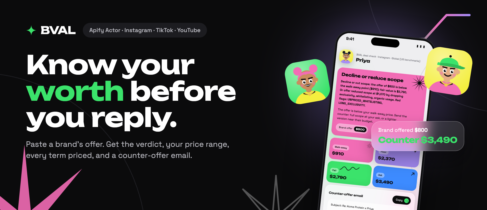
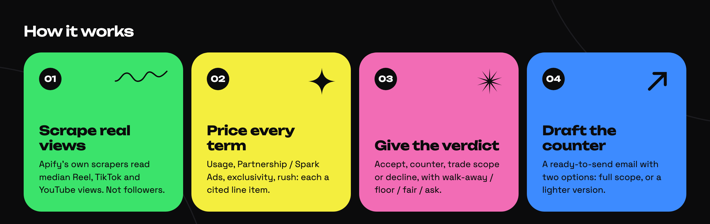
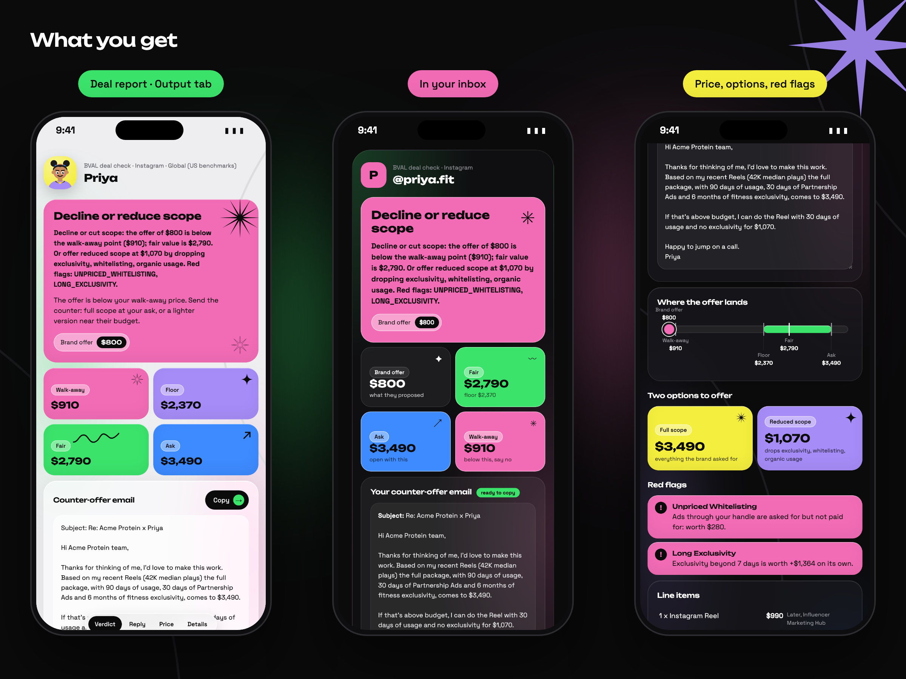

# BVAL: brand-deal rate calculator for creators (Apify Actor)



Paste a brand's offer, get the verdict: fair rate, every term (usage, Partnership/Spark Ads, exclusivity, ...) priced as a dated line item, a walk-away / floor / fair / ask range, red flags, and a counter-offer email. Instagram, TikTok and YouTube, any country.





Built for the Apify "AI Tools that Earn" hackathon, Bengaluru, 22 Nov 2026.

- **Actor code and Store README:** [bval/](bval/) ([README](bval/README.md))
- **Cited pricing research:** [bval_research.md](bval_research.md), [country market factors](reports/BVAL%20country%20market%20factors.md)
- **Build plan and status:** [steps.md](steps.md)

## Run locally

```bash
cd bval
npm install -g apify-cli && apify login
python -m venv .venv && .venv/bin/pip install -r requirements.txt
apify run --input '{"platform":"instagram","handle":"examplecreator","offerAmount":800,"manualMetrics":{"followers":85000,"medianViews":42000,"engagementRate":0.035}}'
.venv/bin/python -m unittest discover -s tests
```

Remove `manualMetrics` to scrape the handle live (uses Apify credit for the Instagram/TikTok/YouTube scrapers).

## README graphics

The images in [assets/readme/](assets/readme/) are drawn from the Actor's own report and email code, so they match what users see. After changing the report style, rebuild them with `bval/.venv/bin/python assets/readme/build_readme_images.py` (needs Google Chrome).
